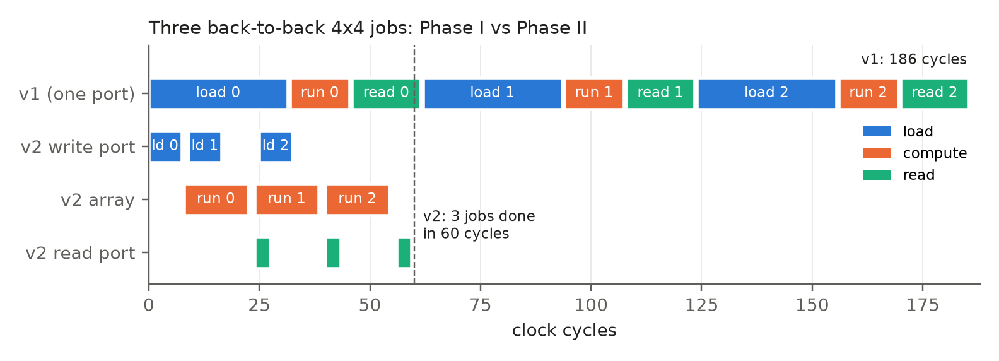

# Systolic Array Matrix Multiplication Accelerator

B.Tech Project 12, Team T013 (Phase I + Phase II)

We built a systolic-array accelerator in Verilog that multiplies N×N matrices (mainly 4×4) of 8-bit signed fixed-point numbers (Q4.4), and compared it against a simple design that uses one MAC unit and does the multiply sequentially. In Phase II we fixed the bottleneck we found in Phase I (moving data in and out took way longer than the actual multiply), made the clock faster, added tiling for bigger matrices, and added a UART link so a PC can use it on a Basys-3 board.

- **Final report:** [report/report.pdf](report/report.pdf)
- **Demo video (Phase I):** https://drive.google.com/file/d/10t8ryxw02DLN9Svh9yfG19ND-GOrFu4N/view?usp=sharing

## Team

| Name | Phase I | Phase II |
|---|---|---|
| Arya Pandey | PE and MAC unit, unit testbenches, fixed-point format | pipelined MAC (`PIPE`), unit tests in both modes |
| Divyansh Rathore | systolic array grid, input skew buffers, output buffer | row-wide double-buffered input buffer, row-read output buffer, buffer testbench |
| Rishita Boisnobi | controller FSM, matrix data interface, sequential baseline | v2 controller (acc mode, banks), v2 top, tiled multiplier + testbench |
| Mohit Singh | Python reference model, matrix testbench, waveforms | stress tests, v2 testbench (streaming, acc mode), regression script |
| Abhishek Sharma | synthesis and timing, performance analysis, report and video | UART bridge, Basys-3 top, host script, UART testbench, synthesis, final report |


## How it works (short version)

- Each PE multiplies the two numbers passing through it and adds the result to its own accumulator. It then passes `a` to the right and `b` down.
- Rows of A enter from the left and columns of B enter from the top. Row i is delayed by i cycles, and column j by j cycles. This "skew" makes the right numbers meet in the right PE.
- After 3N−1 cycles every PE holds one element of C. The controller copies all of them into the output buffer.

## What Phase II added

- **Row-wide, double-buffered I/O.** Load a whole row per clock, into one of two banks. While the array works on bank 0, the next job loads into bank 1, and the last job's results are read out at the same time.
- **Pipelined MAC.** A register between the multiplier and the adder takes the adder off the slowest path, so the clock goes from 84.7 to 98.3 MHz.
- **Accumulate mode + tiling.** `tiled_matmul` does 8×8 and 12×12 multiplies on the same 4×4 array by adding up tile products.
- **UART + Basys-3.** Send matrices from a PC (`host/uart_host.py`), get the answers back over the USB cable.



## Results

4×4 multiply, including loading the inputs and reading the result:

| | Sequential (1 MAC) | Phase I systolic | Phase II (streaming) |
|---|---|---|---|
| Cycles per multiply | 115 | 62 | **16** |
| Max clock (iCE40 HX8K, after place & route) | 58.1 MHz | 83.9 MHz | **98.3 MHz** |
| Time per multiply | 1980 ns | 739 ns | **163 ns** |
| Artix-7 resources (Yosys) | 59 LUT, 36 FF, 1 DSP | 137 LUT, 456 FF, 16 DSP | 272 LUT, 459 FF, 16 DSP |

Bigger matrices (cycles):

| | 8×8 | 12×12 | multipliers |
|---|---|---|---|
| Sequential | 515 | 1731 | 1 |
| Tiled on the 4×4 array | 158 | 487 | 16 |
| Full 8×8 array | 26 | – | 64 |

The regression runs 20 simulations and checks 58,342 results against the Python model, all passing. See `sim/logs/` and `synth/summary.md`.


## Folders

```
rtl/          verilog source
              Phase I:  mac_unit, pe, systolic_array, input_buffer, output_buffer,
                        systolic_controller, systolic_top, seq_matmul (baseline)
              Phase II: input_buffer_v2, output_buffer_v2, systolic_controller_v2,
                        systolic_top_v2, tiled_matmul, uart_rx, uart_tx,
                        uart_bridge, basys3_top
tb/           testbenches (MAC, PE, input buffer, v1 + v2 matrix, tiled, UART)
model/        python script that makes test matrices + the correct answers
scripts/      run_sim.sh (full regression) and run_synth.sh
sim/          test vectors, simulation logs, .vcd waveforms (open in GTKWave or Surfer)
synth/        summary.md, raw reports, vivado scripts
constraints/  Basys-3 pin file
host/         PC program for the board demo
report/       final report pdf + figures
```

## Running it

You need Icarus Verilog and Python 3 with numpy. Yosys and nextpnr-ice40 are only needed for synthesis.

```bash
make sim      # full regression, about 20 seconds
make quick    # same without the stress and UART runs
make synth    # synthesis, results in synth/summary.md
gtkwave sim/waves/tb_systolic_N4.vcd
```

Vivado (Artix-7):

```bash
vivado -mode batch -source synth/vivado_synth.tcl -tclargs systolic_top_v2 4
vivado -mode batch -source synth/vivado_board.tcl     # Basys-3 bitstream
```

Board demo, after programming the Basys-3 and pressing the centre button:

```bash
pip install pyserial numpy
python3 host/uart_host.py --port /dev/tty.usbserial-XXXX
```
