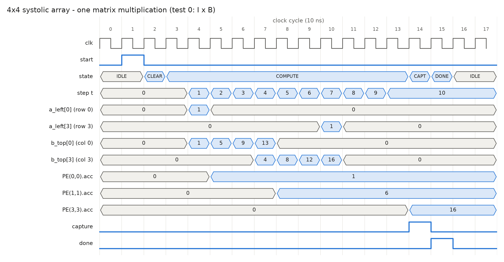

# Systolic Array Matrix Multiplication Accelerator

B.Tech Project 12 (Phase I), Team T013

We built a small systolic-array accelerator in Verilog that multiplies two N×N matrices (we mainly used 4×4). The inputs are 8-bit signed fixed point (Q4.4). We compared it against a simple design that uses one MAC unit and does the multiply sequentially.

- **Report:** [report/report.pdf](report/report.pdf)
- **Demo video:** https://drive.google.com/file/d/10t8ryxw02DLN9Svh9yfG19ND-GOrFu4N/view?usp=sharing

## Team

| Name | Worked on |
|---|---|
| Arya Pandey | PE and MAC unit, unit testbenches, fixed-point format |
| Divyansh Rathore | systolic array grid, input skew buffers, output buffer |
| Rishita Boisnobi | controller FSM, matrix data interface, sequential baseline |
| Mohit Singh | Python reference model, matrix testbench, waveforms |
| Abhishek Sharma | synthesis and timing, performance analysis, report and video |


## How it works (short version)

- Each PE multiplies the two numbers passing through it and adds the result to its own accumulator. It then passes `a` to the right and `b` down.
- Rows of A enter from the left and columns of B enter from the top. Row i is delayed by i cycles, and column j by j cycles. This "skew" makes the right numbers meet in the right PE.
- After 3N−1 cycles every PE holds one element of C. The controller copies all of them into the output buffer.

## Results (4×4)

| | Systolic | Sequential (1 MAC) |
|---|---|---|
| Cycles per multiply | **14** | 67 |
| Max clock (iCE40 HX8K, after place & route) | **79.2 MHz** | 58.1 MHz |
| Time per multiply | **177 ns** | 1154 ns (6.5× slower) |
| Artix-7 resources (Yosys) | 137 LUT, 456 FF, 16 DSP | 59 LUT, 36 FF, 1 DSP |

At 8×8 the gap grows to 26 vs 515 cycles. All tests pass for 3×3, 4×4 and 8×8. See `sim/logs/`.



## Folders

```
rtl/      verilog source (mac_unit, pe, systolic_array, input/output buffers,
          controller, systolic_top, seq_matmul = baseline)
tb/       testbenches (MAC, PE, full matrix multiply)
model/    python script that makes test matrices + the correct answers
scripts/  run_sim.sh and run_synth.sh
sim/      test vectors, simulation logs, .vcd waveforms (open in GTKWave)
synth/    synthesis results (summary.md), raw reports, vivado script
report/   final report pdf + figures
```

## Running it

You need Icarus Verilog and Python 3 with numpy. Yosys and nextpnr-ice40 are only needed for synthesis.

```bash
make sim      # makes test vectors and runs every testbench
make synth    # synthesis, results go in synth/reports
gtkwave sim/waves/tb_systolic_N4.vcd
```

For Vivado (Artix-7):

```bash
vivado -mode batch -source synth/vivado_synth.tcl -tclargs systolic_top 4
```
