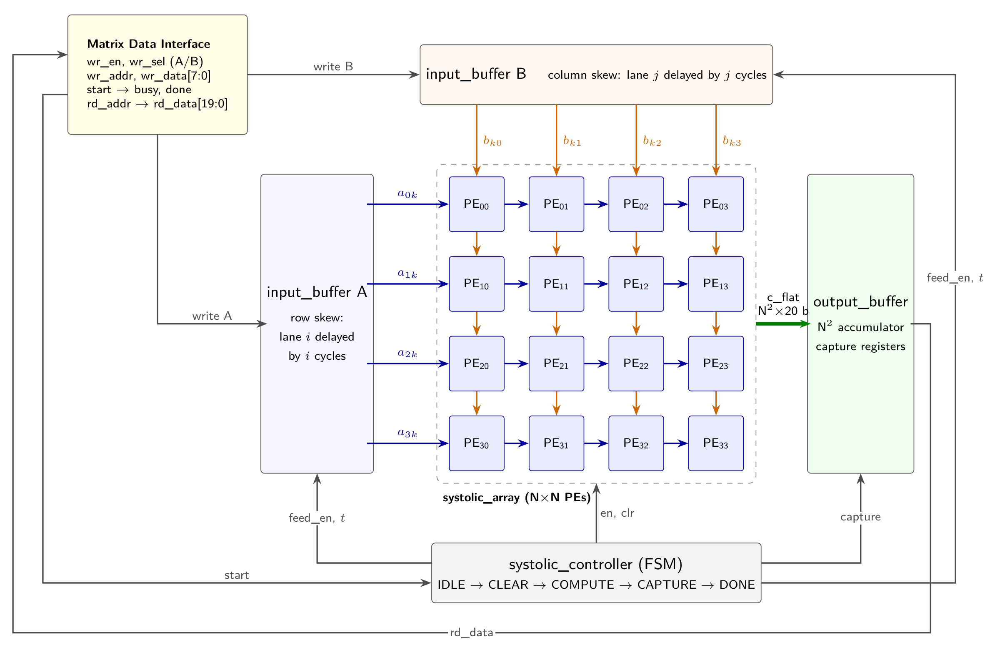
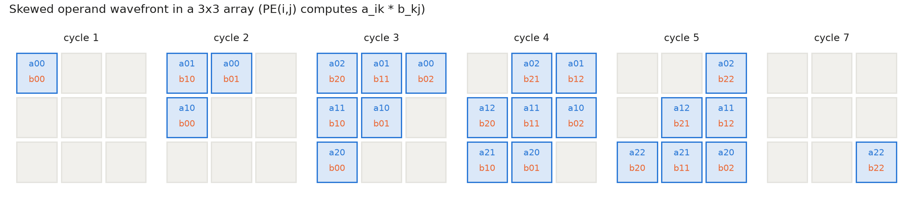

# Systolic-Array Matrix-Multiplication Accelerator (Verilog)

A parameterized **output-stationary systolic array** that multiplies two N×N signed 8-bit fixed-point (Q4.4) matrices. It comes with a sequential single-MAC baseline, self-checking testbenches, a Python golden model, and open-source synthesis and place-and-route results.

> **B.Tech Project 12, Phase I.** Report: [`report/report.pdf`](report/report.pdf) · Demo video: **<add link here>**

**Team:**
- **Arya Pandey**: PE and MAC unit, unit testbenches, fixed-point format
- **Divyansh Rathore**: systolic-array grid, input skew buffers, output buffer
- **Rishita Boisnobi**: controller FSM, matrix data interface, sequential baseline
- **Mohit Singh**: Python reference model, matrix testbench, waveform analysis
- **Abhishek Sharma**: synthesis and timing flow, performance analysis, report and video



## Key results (4×4 array)

| Metric | Systolic 4×4 | Sequential (1 MAC) | Gain |
|---|---|---|---|
| Latency, start→done | **14 cycles** (3N+2) | 67 cycles (N³+3) | 4.8× |
| Fmax, iCE40-HX8K post-route | **79.2 MHz** | 58.1 MHz | 1.36× |
| Time per matrix multiply | **177 ns** | 1154 ns | **6.5×** |
| Throughput (single job) | 4.57 MAC/cycle = 362 MMAC/s | 0.96 MAC/cycle = 55.5 MMAC/s | 6.5× |
| Artix-7 resources (Yosys) | 137 LUT, 456 FF, 16 DSP48E1 | 59 LUT, 36 FF, 1 DSP48E1 | n/a |
| Area–delay product (iCE40) | 0.96 M LC·ns | 1.57 M LC·ns | 1.64× better |

At N = 8 the cycle speed-up is **19.8×** (26 vs. 515 cycles). All 84 matrix tests (14 per size × N = 3, 4, 8 × both designs) and every MAC/PE unit check pass.


## Repository layout

```
rtl/                     synthesizable Verilog-2001
  mac_unit.v             signed MAC (Q4.4 x Q4.4 -> Q12.8 accumulator)
  pe.v                   processing element: a/b forwarding regs + MAC
  systolic_array.v       N x N generate grid of PEs
  input_buffer.v         matrix storage + diagonal skew feeder (A rows / B cols)
  output_buffer.v        N^2 result capture registers + read port
  systolic_controller.v  FSM: IDLE -> CLEAR -> COMPUTE -> CAPTURE -> DONE
  systolic_top.v         top level + matrix data interface
  seq_matmul.v           baseline: single-MAC sequential multiplier (same ports)
tb/
  tb_mac_unit.v          13 directed MAC checks
  tb_pe.v                7 directed PE checks (forwarding, stall, clear, dot product)
  tb_matmul.v            self-checking matrix bench (systolic, or baseline with -DSEQ)
model/gen_vectors.py     NumPy golden model + test-vector generator
scripts/
  run_sim.sh             all simulations -> sim/logs, sim/waves (VCD)
  run_synth.sh           Yosys (Artix-7) + nextpnr (iCE40) -> synth/reports
  summarize_synth.py     builds synth/summary.md
  make_figures.py        waveform, dataflow and performance plots
synth/
  summary.md             resource / Fmax table for N = 2, 3, 4, 8
  vivado_synth.tcl       Vivado batch flow for Artix-7 (Basys-3 part)
  reports/               raw Yosys and nextpnr logs
sim/vectors, sim/logs, sim/waves   test vectors, simulation logs, VCD waveforms
report/                  IEEE-format report (LaTeX source, PDF, figures, TikZ diagrams)
docs/video_script.md     5-minute demo video outline
```

## How it works

* **Dataflow.** Row *i* of A enters PE(i,0) from the left and moves right. Column *j* of B enters PE(0,j) from the top and moves down. PE(i,j) accumulates C[i][j] in place, so the dataflow is output-stationary.
* **Skew.** The input buffers delay lane *l* by *l* cycles, so a<sub>ik</sub> and b<sub>kj</sub> meet in PE(i,j) at cycle i+j+k+1. Lanes outside their window carry zero, the neutral value for a MAC. The PEs therefore need no per-PE valid logic.
* **Latency.** The compute phase takes 3N−1 cycles. One cycle each for CLEAR, CAPTURE and DONE gives 3N+2 from start to done.
* **Number format.** Q4.4 inputs give exact Q8.8 products, which accumulate in a 20-bit Q12.8 register. There is no overflow for N ≤ 32.



## Running it

Requirements: Icarus Verilog, Yosys, nextpnr-ice40, and Python 3 with numpy and matplotlib. GTKWave is optional; Tectonic or any LaTeX install builds the report.

```bash
brew install icarus-verilog yosys nextpnr-ice40 tectonic   # macOS
python3 -m venv .venv && .venv/bin/pip install numpy matplotlib
make sim       # generate vectors + run every testbench
make synth     # Yosys / nextpnr synthesis + summary table
make figures   # regenerate plots in report/figures
make report    # build report/report.pdf
make all       # everything
gtkwave sim/waves/tb_systolic_N4.vcd   # inspect waveforms
```

Vivado (Artix-7, exact post-route timing):

```bash
vivado -mode batch -source synth/vivado_synth.tcl -tclargs systolic_top 4
```

### Host interface

| Signal | Dir | Description |
|---|---|---|
| `wr_en`, `wr_sel` | in | write strobe; 0 selects A, 1 selects B |
| `wr_addr`, `wr_data[7:0]` | in | element address (row·N+col), Q4.4 value |
| `start` | in | one-cycle pulse that starts the multiplication |
| `busy`, `done` | out | busy while computing; `done` pulses for one cycle |
| `rd_addr`, `rd_data[19:0]` | in/out | combinational result read (Q12.8) |

## Synthesis summary

See [`synth/summary.md`](synth/summary.md). Xilinx numbers come from Yosys `synth_xilinx` and are estimates taken before placement. iCE40 numbers come from nextpnr after place-and-route on an HX8K. That part has no hard multipliers, so it is LUT-heavy.

## Phase II roadmap

1. Run on an Artix-7 board with a UART host bridge, and report Vivado timing and utilization.
2. Overlap consecutive jobs to raise PE utilization above the current 36% (single job, N = 4).
3. Widen the load path to one row per cycle; I/O currently limits end-to-end speed-up to 1.85×.
4. Tile larger matrices over the 4×4 array.

## References

H. T. Kung, "Why systolic architectures?", *IEEE Computer*, 1982 · N. P. Jouppi et al., "In-datacenter performance analysis of a tensor processing unit", ISCA 2017. The full list is in the report.
